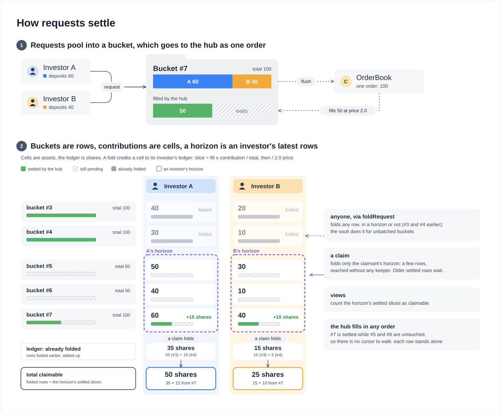
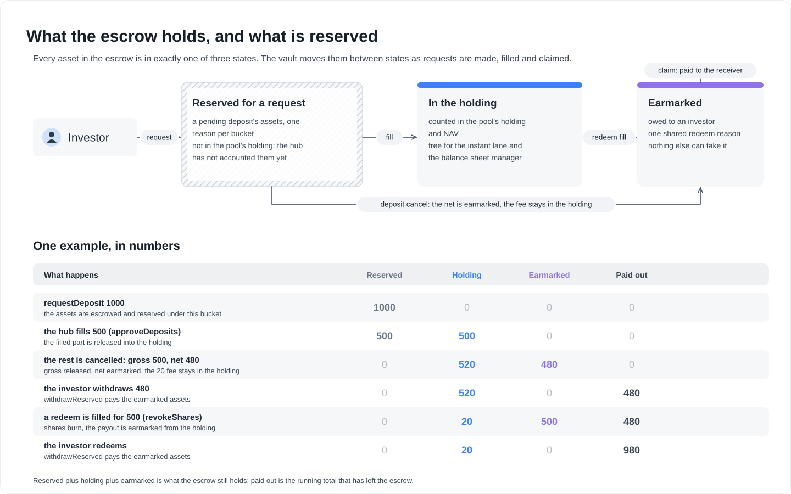
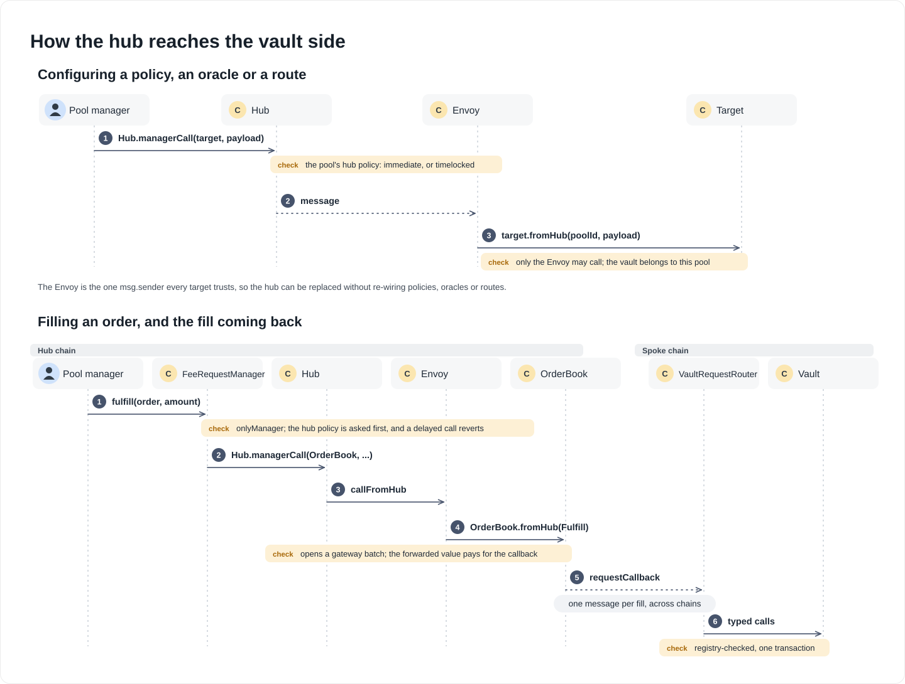
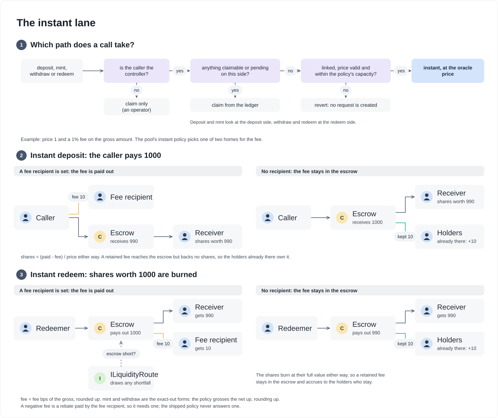

# Vault Development Kit: architecture

How the VDK works: the two lanes, how a request settles into claimable shares, how claims are kept current, and how a liquidity route backs an instant exit. [`README.md`](README.md) says what the kit is and how to build on it, and [`SPECIFICATION.md`](SPECIFICATION.md) states what it guarantees. The contract relationship diagrams are in [`docs/architecture/vaults`](../../docs/architecture/vaults/).

### Glossary

| Term | Meaning |
|---|---|
| **Controller** | The address that owns a request and its claims (ERC-7540). An **operator** acts for a controller; the **owner** is who funds the request. |
| **Sponsor** | A payer the vault's instant policy accepts (a per-vault list the pool sets from the hub, nobody by default): it may fund a position for a controller it does not act for, without any say over its claims. Anyone else can only credit itself or a controller it is the operator of, except by a request transfer on a vault without an instant lane. |
| **Bucket** | The pooled requests that reach the hub as one order, named by a `localId`. The request id is `vault << 96 \| localId`. |
| **Contribution** | A controller's share of one bucket. |
| **Position** | A controller's contribution in one bucket: what the horizon lists. |
| **Flush** | Sending a bucket's queued amount to the hub as one order. |
| **Fill** | The hub answering a bucket, in full or in part. It is recorded once on the bucket (**settle**). |
| **Leg** | One step of applying a fill: approve, issue and fulfill for a deposit, revoke and fulfill for a redeem. |
| **Fold** | Crediting a contribution's newly settled slice to its controller's ledger. |
| **Ledger** | A controller's claimable shares and assets, summed across positions (`InvestmentState`). |
| **Horizon** | A controller's latest few positions: the subset a claim folds on its own. |
| **Fee, retained fee** | An instant trade's fee goes to its recipient, or, when the policy names none, stays in the escrow for the holders already there (retained). |
| **Route** | An `ILiquidityRoute`: where an instant redemption draws liquidity when the escrow is short. |
| **Envoy** | The stable `msg.sender` through which the hub reaches the plugins (`fromHub`). |
| **Variant** | A number that lets several vaults exist for one pool, share class and asset. |

### Async lane

A request is funded when it is made: `requestDeposit` moves the assets into the escrow, notes and reserves them (the two queued updates cancel, so the hub sees nothing yet); `requestRedeem` parks the shares there. The request policy names the bucket by a key of its own, and the vault keeps one bucket per key and side and allocates its id: one per investor, one per request, or one per dealing window, in which case the whole window reaches the hub as one order and one message, flushed by the vault when a request opens the next window and the previous one has closed, or by anyone through `flushRequest`. Request ids are vault-namespaced (`vault << 96 | localId`), so parallel vaults on one position never collide.

`VaultRequestRouter`, the per-network contract a pool registers as its spoke request manager, serializes the request onto the wire and applies the hub's callbacks to the vault as typed calls, checking the callback's position against the registry. On the hub, `OrderBook` auto-approves each request into an outstanding order; the manager fills it at prices and net amounts it supplies (bounded by the pool's hub policy, e.g. `StdHubPolicy`), in one `SettledDeposit` or `SettledRedeem` callback, or cancels it with a gross and a net amount. A partial fill leaves the rest outstanding for the next one, which is how gates with carry-over work. On the spoke, `BucketLib` settles the bucket and each contributor folds a floor pro-rata slice into their claimable ledger at a blended price, claimed through the ERC-7540 `deposit`/`mint` and `withdraw`/`redeem`. Cancellations are manager-initiated, order-level, and claimed on the opposite side, so standard integrators recover them without new methods.

### How a request settles

A request becomes a **contribution** to a **bucket**, which is the unit the hub sees as one order. Settlement is recorded once on the bucket; each contributor's slice only reaches their claimable ledger when it is **folded**. The **horizon** is the short list of a controller's latest positions that every claim folds first. It only bounds what a claim folds on its own: a bucket the request policy did not batch folds at settlement, and `foldRequest` folds any position, in the horizon or not. The views also count the horizon's settled slices as claimable, and the instant-or-claim routing reads the controller's pending total.



### Why this shape

Five constraints lead to buckets, contributions and a horizon:

1. **ERC-7540 claims are per controller, not per request id.** A claim needs the controller's total claimable, so each controller has a ledger that adds up across positions.
2. **A shared window bucket has an unbounded number of contributors.** Settling must not touch each of them, so the hub callback stays O(1): the settlement is recorded once on the bucket and each contribution is folded into its ledger later.
3. **The hub fills buckets in any order, and in part.** Settlement cannot be walked in sequence: a bucket the manager has not touched must not block newer ones that settled. So there is no cursor, each position stands alone, and a claim looks at the latest few positions, not the oldest.
4. **A controller can hold any number of positions.** It opens them itself, its operators open them for it, a sponsor the pool allowed can fund them, and on a vault without an instant lane anyone can transfer one to it. No cost or limit may depend on how many it holds.
5. **Views must be cheap and match what a claim would do.** They read the horizon's settled slices and per-controller pending totals, never every position.

The horizon is the bounded answer to 3 to 5: the controller's latest positions, which a claim folds and the views read. It is the general mechanism for batches, which cannot fold at settlement. The vault folds an unbatched bucket as it settles, so the shipped per-investor and per-request policies run the horizon at 1 and only `PerPeriodPolicy` leans on it today. Positions outside it are folded by `foldRequest`.

What each piece holds:

| Piece | Holds |
|---|---|
| **Bucket** (one hub order) | `total`, the sum of the contributions and the pro-rata denominator; `queued`, what has not gone to the hub yet; `fulfilled*` and `cancelled*`, what the hub answered, cumulatively; `settlements`, bumped once per hub answer |
| **Contribution** (bucket and controller) | `amount`, the controller's share of `total`; the folded snapshots, what was already credited; `foldedSettlements`, which equals the bucket's when there is nothing new to fold |
| **Horizon** (controller and side) | the controller's latest positions, oldest first, at most `foldHorizon` of them |

A shared window with two contributors shows the arithmetic. A contributes 60 and B contributes 40, so `total` is 100. The hub fills 50 for 25 shares. A's slice is `50 x 60 / 100 = 30` assets and `25 x 60 / 100 = 15` shares, B's is 20 and 10, each rounded down, and the rounding dust stays in the escrow. A later fill of the same bucket only adds the difference to each snapshot. With a per-request or per-investor policy the controller is the bucket's only contributor, so the slice is the whole fill and the vault folds it the moment it settles.

### Horizon rules

A claim folds a controller's **horizon**: its latest `foldHorizon` positions on each side, fixed when the vault is deployed: at least the request policy's `maxOpenBuckets`, which is also the default; a batching pool whose investors wait on closed but unsettled batches configures more. The vault sets no upper bound: a large horizon makes the pool's own claims costlier, which is the pool's choice. It is never below `maxOpenBuckets`, and a position the controller did not request themselves (a sponsor's, or one transferred in) never takes a slot kept for their open buckets, so their request never evicts an open one. The rules:

- **Who enters.** Every position the controller is credited with, by its own request, its operator's, a sponsor's or a transfer. A full horizon makes way by its oldest entry, which is folded if it has settled.
- **What a claim does.** It folds every position in the horizon first, so the claim sees the controller's full claimable balance. Positions still unsettled stay in the horizon.
- **Outside the horizon.** A position evicted while unsettled is folded at settlement when its bucket is unbatched, or by anyone through `foldRequest(localId, controller)`. That call is permissionless and does nothing for a position with nothing left to fold, so a keeper can batch folds through a multicall. With `PerPeriodPolicy`, a controller holding more windows than its horizon sees the older settled ones as pending until then, so an indexer or SDK should run the keeper for vaults whose investors hold many windows. `BucketSettled`, `BucketOpened` (whose key is the window's index) and `contribution(localId, controller)` say which windows need one, and each controller's `RequestFolded` reports what is still pending after every fold.
- **Keeper-free up to the horizon.** A controller whose positions all fit in the horizon never needs a fold keeper. Beyond it, a keeper is needed for the older settled windows.
- **Eviction and routing.** An evicted position that is still unsettled keeps counting as pending, so the instant lane stays closed while it is open, and once a batch settles it reads as pending until something folds it. The vault's horizon therefore always holds a controller's open buckets, and a batching policy's default keeps 7 more slots for batches that closed but have not settled; a vault whose investors leave more unsettled configures a larger one.
- **Views.** `maxMint`, `maxWithdraw`, the `claimable*` and the `pending*` views count the horizon's settled slices as claimable and read per-controller pending totals, so no number of positions makes them costlier.
- **Routing.** The instant lane opens only with nothing claimable and nothing pending on that side, read from the controller's pending total rather than the horizon. A sponsor's pending position closes it like the controller's own request.

A settlement lands on a bucket once, and folds are lazy so the hub callback stays cheap. Where a settled position waits until it is folded:

```
settle (bucket)  ->  position waits, unfolded
                       |
       +---------------+-----------------+
       |                                 |
in the horizon                    outside the horizon
folded by the controller's        folded at settlement (unbatched)
next claim; views count it        or by anyone via `foldRequest`
as claimable meanwhile
```

The vault names each position left outside in `OutsideHorizon`, for a keeper to follow.

The deployment consequences are in the specification's [Deployment constraints](SPECIFICATION.md#deployment-constraints).

### Settlement callbacks

The hub sends one `SettledDeposit` or `SettledRedeem` per fill, which the router applies to the vault as its legs in one call: a deposit runs `approveDeposits`, `issueShares` and `fulfillDepositRequest` in order, a redeem `revokeShares` and `fulfillRedeemRequest`. Each settlement, fill or cancellation, ends in one place: the vault settles the bucket, emits `BucketSettled`, folds an unbatched bucket into its owner, and then tells the settlement observer, with the fill's assets and shares or a cancellation's gross and net, the figures of `BucketSettled`. The legs before it emit no event of their own. What a deposit's approval or cancellation releases from the request's reservation, which the clamp can make less than the callback's amount, is the escrow's `DecreaseReserve` under the request's reason (`keccak256(abi.encode(REASON_DEPOSIT, localId))`), and an approval also reports it in `ForwardedToRoute` when a liquidity route is set; the shares minted or burnt are the share token's `Transfer` events.

### Escrow reservations

A vault never holds assets itself: they sit in the pool's escrow, and the vault asks the spoke to reserve them under a **reason**. Every asset in the escrow is in one of three states:

- **Reserved for a request.** A pending deposit's assets, under a reason of their own bucket. They are not in the pool's holding yet, so the hub has not accounted them.
- **In the holding.** Counted in the pool's holding and NAV, and available to the instant lane and the balance sheet manager.
- **Earmarked.** Owed to an investor under the shared redeem reason, so nothing else can take it.

The moves: a request reserves the deposit; `approveDeposits` releases the filled part into the holding; a redeem fill (`revokeShares`) earmarks the payout out of the holding; a claim pays the earmark out (`withdrawReserved`). A deposit cancellation releases the gross amount and earmarks the net, because a cancelled deposit is claimed on the opposite side, as a withdrawal; the difference stays in the holding as a retained fee.



### How the hub reaches the vault side

Everything the pool configures on the vault side, and every fill of an order, reaches it the same way, through the **Envoy**: a stateless dispatcher that is the fixed `msg.sender` targets bind to, so the hub can be redeployed without rewiring them.



- **Configuration.** A pool manager calls `Hub.managerCall(poolId, centrifugeId, target, payload, ...)`. The pool's hub policy decides whether the call is immediate or timelocked. A message carries it to the chain of the target, where the Envoy calls `target.fromHub(poolId, payload)`. The targets that take configuration (`ReserveInstantPolicy`, the oracle, the liquidity routes, the fee manager and the router) accept `fromHub` from the Envoy only, and where they configure a vault they check that it belongs to the calling pool. The request policies take no configuration after construction.
- **Filling an order.** The manager calls `FeeRequestManager.fulfill`, which first asks the pool's hub policy about the same call as the original manager would make, so an out-of-policy fill fails before any message is sent, and then calls `Hub.managerCall` itself. The Envoy hands the fill to `OrderBook.fromHub`, which opens a gateway batch around it (`withBatch`) so the value the manager forwarded pays for the callback and anything else queued. `lockCallback` makes the batch body callable only from that batch, and only once.
- **The callback.** `OrderBook` sends one `SettledDeposit`, `SettledRedeem` or cancellation message per fill. On the spoke, `VaultRequestRouter` checks the callback's position against the registry and applies it to the vault as typed calls in one transaction.

### Instant lane

With an instant policy set, `deposit`, `mint`, `withdraw` and `redeem` execute at the oracle's prices up to the policy's capacity, charging the spread on the gross, when the caller itself uses the ERC-4626 forms and has nothing claimable and nothing pending. With anything claimable or pending they claim instead, never a mixture. The 3-argument `deposit` and `mint` are ERC-7540 claims and nothing else: with nothing claimable they revert, so a retried claim never turns into a purchase. The 3-argument `withdraw` and `redeem` share their selector with ERC-4626's owner form, so for the owner they take the instant lane like the 2-argument ones, and an operator can only claim. A redemption larger than the escrow can pay draws the shortfall from the liquidity route in the same transaction. Capacity is reported by `maxWithdraw`/`maxRedeem`; an instant call above it reverts (`ExceedsRedeemLimits`) rather than turning into a request, so an investor who cannot be served instantly calls `requestRedeem`. A paused, stale or skewed price closes the instant lane and the previews while async settlement and claims carry on, since those price from the stored ledger.

Which entrypoint an instant call takes is decided once, by the controller's own state:



#### Where an instant fee goes

The instant policy answers each trade with a fee and a recipient. The shipped `ReserveInstantPolicy` charges basis points of the **gross** amount, rounded up. The recipient decides where the fee goes:

- **A recipient is set:** the fee is paid to it.
- **No recipient (`address(0)`):** the fee is retained. It stays in the escrow and backs no shares, so it accrues to the holders who remain.

In an instant deposit of `gross` assets, the caller pays the fee to the recipient and the rest to the escrow, or the whole `gross` to the escrow when the fee is retained; either way the shares minted are worth `gross - fee`. In an instant redeem, shares worth `gross` are burned and the receiver gets `gross - fee`; the escrow pays the fee out to the recipient, or keeps it. `mint` and `withdraw` are the exact-out forms: the policy grosses the net up, rounding up. A negative fee is a rebate paid by the recipient, which must then be set; no shipped policy answers one. A pool that wants both a manager fee and a holder spread names a splitter contract as the recipient. The splitter is a balance sheet manager: a permissionless `split()` pays the manager's share and deposits the rest back into the escrow, where it is retained. It runs after the trade, not inside it: until it is called the holders' share sits in the splitter and NAV is understated, and the splitter's manager role is not scoped to this job, so it should be minimal and immutable.

#### Backing a fund-of-funds with Basin

`VaultLiquidityRoute` releases a fund of funds' positions in underlying vaults on demand, through each underlying's own instant exit, so whatever backs the underlying backs the top-level exit in one transaction. It quotes each position at the lower of `previewRedeem(held)` and `withdrawCapacity`, net of the underlying's exit fee, and an underlying that cannot quote reads as zero rather than reverting.

```
direct     FoF vault -- BasinLiquidityRoute --> basin pays the vault, which forwards to the FoF escrow           debt: the FoF pool
composed   FoF vault -- VaultLiquidityRoute --> underlying vault.withdraw
                                                 └ BasinLiquidityRoute --> basin pays its escrow   debt: underlying pool
```

`BasinLiquidityRoute` keys its credit line and receivable by the drawing vault, so it backs either topology; the debt is the drawing pool's.

#### Basin debt on the balance sheet

A Basin draw is a loan, so the cash it lands in the escrow is owed back. The route books it in the same transaction: it mints liability `AccountingToken`s for the drawn principal (id `toTokenId(pool, asset, true)`) and deposits them into the vault's share class in the pool's escrow, and `repay` withdraws and burns them. Both legs reach the hub in one snapshot, so NAV per share is unchanged by a draw and by its repayment. A pool enabling Basin configures, before the first draw:

1. The route as a spoke manager of the pool (`hub.updateManager`, `ManagerKind.Spoke`), and its spoke policy, if any, allowing the route's `deposit` and `withdraw` of the liability token.
2. The route as a minter of the pool's accounting tokens (`hub.managerCall` to `AccountingToken`, payload `abi.encode(bytes32 route, true)`).
3. The liability token as a spoke asset (`spoke.registerAsset(hubCentrifugeId, accountingToken, liabilityId, refund)`, permissionless, once per pool and asset).
4. On the hub, that asset as a liability holding of the share class (`NAVManager` `InitializeLiability`, or `initializeHolding` with a credit-normal liability account), valued like the asset it is owed in.

Without 1 to 3 the route reports no capacity and a draw reverts. Step 4 is invisible to the spoke: until it is done the hub tracks the debt's amount but not its value, so NAV overstates by what is owed (see the specification's liquidity route section).

### Share token restrictions

The share token's hook decides who may hold, leave or be paid; the vault decides what each of its actions asks, and of whom. `VaultActionLib` turns an action into role checks and asks the token's current hook once (`IRoleHook.onRoles`), each check naming the account that answers to the role and the one the value comes from, so the hook can also relate the two:

| Action | Role checks |
|---|---|
| `requestDeposit` | `Entry` of the controller, from the owner |
| deposit claim (`deposit`, `mint`) | `Entry` of the controller, and of the receiver from the controller |
| instant `deposit`, `mint` | `Entry` of the caller, and of the receiver from the caller |
| deposit request transfer | `Entry` of the new holder, from the old one |
| `requestRedeem` | `Exit` of the owner, and of a distinct controller from the owner |
| redeem claim (`redeem`, `withdraw`) | `Payout` of the receiver, from the controller |
| instant `redeem`, `withdraw` | `Exit` of the caller, and `Payout` of the receiver from the caller |
| redeem request transfer | `Exit` of the new holder, from the old one |
| refund taken back by the controller | `Refund` of the controller |

The share legs that move through the token (an issuance, a delivery out of the escrow) also pass its transfer hook. Who may fund a position credited to another controller is not the hook's question: such a position, pending on the controller's ledger, holds its instant lane closed until it settles, so a vault with an instant lane asks its instant policy (`canCredit`). `ReserveInstantPolicy` answers from a per-vault sponsor list the pool sets from the hub, nobody by default.

### Deployment

`Vault` is about 43 kB of runtime code (`forge build --sizes` has the current figure), over EIP-170 and under the 64 KiB code and 128 KiB initcode limits of EIP-7954, which Ethereum schedules for Glamsterdam (the earlier EIP-7907 proposal set the same limits, and the deployment tooling still uses its name), and `VaultFactory` carries its creation code, so the spoke half (`VaultFactory`, `VaultRequestRouter`, `VaultRouter`, `SpokeOracle`, the request policies, `ReserveInstantPolicy`, `VaultLiquidityRoute`) deploys only where the chain config sets `network.vaults`; `LaunchDeployer` refuses the flag on a chain without EIP-7907. The hub half (`OrderBook`, `FeeRequestManager`) fits EIP-170 and deploys on every chain, so a hub without EIP-7907 still settles vaults on its spokes. `BasinLiquidityRoute` is deployed per venue, outside `FullDeployer`. A vault comes up in four steps, after the share class is on the spoke:

1. Anyone calls `VaultFactory.deploy(poolId, scId, asset, 0, payload)` on the spoke, with the payload the hub will send, `abi.encode(VaultPlugins, uint64 variant, uint256 foldHorizon)`. It is a transaction of its own, so the roughly 9M gas it costs today, almost all of it the code deposit, is never priced into a cross-chain message. That cost is about to change by a factor of seven; see the next section. The address commits to the payload, so a deploy by someone else lands the same vault, and a vault the pool never links is inert.
2. The hub sends `UpdateVault.DeployAndLink` with the same payload, which registers and links the vault at that address. Arriving first, it fails on the spoke with `VaultNotDeployed()` and is retried through the gateway once the vault exists; on the hub's own chain the hub's call reverts instead.
3. The hub sends `UpdateManager` for the pool's spoke manager role.
4. For the ERC-7575 pointer on the share token (what `VaultRouter.getVault` and integrators read), the hub sends a `SetVault` through the share token registrar (`managerCall` to the registrar, `abi.encode(RegistrarCall.SetVault, scId, assetId, vault)`). Linking does not set it, and it clears when the vault is unlinked and the pointer is set to zero.

Retiring a vault is draining it, then `Unlink`, and the manager role stays until the claims are paid. An unlinked vault's request router refuses to flush its windows or deliver its callbacks, so open orders are flushed and settled or cancelled first. Every claim pays through the Spoke (`withdrawShares`, `withdrawReserved`, `transferSharesFrom`) as a call by the vault, which needs the vault to still be a manager of the pool, so `UpdateManager(false)` while claims are outstanding freezes them with `NotManager`. The vault never pauses the oracle or repays a Basin line itself, so the role protects nothing once the claims are paid, and revoking it then is housekeeping and not a safeguard. Linking and unlinking do not touch the ERC-7575 pointer, so the hub also sends `SetVault(0)`, or `SetVault(replacement)` once the replacement is linked: otherwise `share.vault(asset)` keeps naming the retired vault and `VaultRouter.getVault` reverts `InvalidVault`.

#### Deployment cost under EIP-8037

The same Glamsterdam fork that raises the size limit (EIP-7954) prices state creation separately (EIP-8037): a deployed byte costs 1,530 gas as state gas instead of 200, and a new account and each new storage slot cost state gas too. The transaction cap of EIP-7825 (2^24) then binds the execution gas only, so a deployment fits it, but the whole cost has to fit the block's gas limit as one transaction. Measured on this branch (`VaultFactoryTest.testDeploymentCostToday`) and applying the draft's schedule:

| | Today's pricing | EIP-8037 draft |
|---|---|---|
| One `VaultFactory.deploy` (43 kB vault) | about 9M gas | about 66M gas |
| `VaultFactory` itself, once per network (49 kB) | about 10M gas | about 75M gas |

So where the larger limit is active, one vault is a transaction as large as today's whole block gas limit, and a pool that runs several vaults on a position pays it for each. The parameters are drafts, and the vault does not deploy on Ethereum before the fork (the size limit and the pricing arrive together), so the figure that matters is the final one. The options, none built yet: deploy the vault's logic once and each vault as a minimal clone carrying its configuration as immutable arguments (roughly a thousandth of the cost per vault, at the price of reading configuration from calldata and an audit of that change); link the settlement libraries (`BucketLib`, `HorizonLib`) instead of inlining them, which saves a share of the code but not enough to reach the old limit; or return to a split vault with shared facets, which the first version of this branch was.

The vault has Root as its only ward, for `recoverTokens`. Policy terms are set per pool through the Envoy (`fromHub`), under the pool's hub policy.

### Coming from the v1 vaults

For an integrator or SDK built on `AsyncVault`, `SyncDepositVault` and the old `VaultRouter` (still on main until this lands):

- **Gone:** the investor-initiated cancellations (`cancelDepositRequest`, `cancelRedeemRequest` and their claims; cancellation is the manager's, at order level, and the cancelled amount is claimed on the opposite side), `authorizeOperator` and its typehash, `isPermissioned` (ERC-7714), `setEndorsedOperator`, `priceLastUpdated`, `deploymentChainId`, `hasPermissions`, the router's `enable` and `disable` and its `cancel*` calls.
- **Different:** a request, and on a vault with an instant lane a request transfer, can only credit a controller the caller is, or is the operator of, unless the payer is a sponsor of the vault (an ERC-7540 caller that names another controller reverts otherwise); `claimable*Request` ignore the `requestId`; the per-investor policy reuses a request id once it settles; refund claims emit `Withdraw`/`Deposit` with zero shares or assets and `maxDeposit`/`maxRedeem` read zero for refunds (claim them with `mint`/`withdraw`); a single vault serves both lanes, and its 3-argument `deposit`/`mint` are claims only, while the 3-argument `withdraw`/`redeem` take the instant lane for the owner when nothing is claimable, so a redemption claim a v1 integrator retries after it already landed burns the caller's own shares at the oracle price less the spread instead of reverting; there is no `investments(controller)` or blended price: `claimableMint` and `claimableWithdraw` give the claimable shares and assets (refunds included, whatever lane a call would take), beside the standard `claimableDepositRequest`, `claimableRedeemRequest` and `pending*Request`.
- **New:** one hub message per fill applied as its legs, vault-namespaced request ids, `foldRequest`, `RequestFlushed`, `BucketOpened`, `BucketSettled`, `RequestFolded`, `InstantFees`, `ForwardedToRoute` and `VaultDeployed` events, `claimableMint`/`claimableWithdraw`, the instant lane's `maxDeposit`/`maxWithdraw` views, and the investor-facing `VaultRouter` (an investor makes it their operator with `vault.setOperator`).
- **Deployment:** the vault is over EIP-170, so it deploys only on chains with EIP-7907, and the share token's hook has to implement `IRoleHook` (the four shipped hooks do), so a live share token needs its hook swapped. There is no migration of open v1 requests in this PR.
