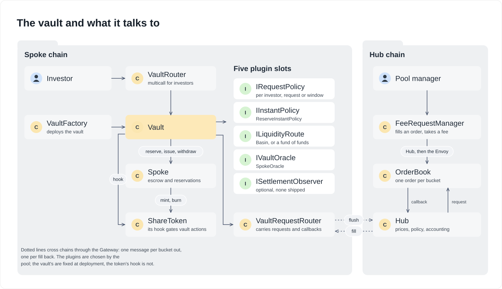

# Vault Development Kit

The Vault Development Kit (VDK) is one vault contract, configured rather than forked. `Vault` is a single immutable contract per `(pool, share class, asset, variant)` that serves both an instant lane (ERC-4626 deposits and redemptions at oracle prices) and an async lane (ERC-7540 requests settled by the pool's hub), with ERC-7575 multi-asset shares and ERC-8161 transferable pending requests. Product behavior lives in narrow plugin contracts fixed at construction, so a tokenized treasury (instant exits from a liquidity buffer or Basin, plus dealing windows), private credit (notice periods, gates, lockups), a yield-bearing token (cooldown exits), a fund of funds (instant exits through the underlying funds' own liquidity) and tranched credit (a hub-side waterfall) are the same bytecode with different plugins. How it works under the hood, with diagrams, is in [`ARCHITECTURE.md`](ARCHITECTURE.md).

[`SPECIFICATION.md`](SPECIFICATION.md) states what the stack guarantees and what it deliberately does not, row by row with the tests behind each. [`docs/vaults-policies.md`](../../docs/vaults-policies.md) evaluates dozens of real fund mechanics against the policy surface and records how each is expressed, or why it is out of scope.

### The two lanes

**Async.** A request is funded when it is made and joins a bucket that the request policy picks: one per investor, one per request, or one per dealing window. The bucket reaches the hub as one order, the hub's manager fills or cancels it, and each investor's slice is credited to their claimable ledger when it is folded, then claimed through the ERC-7540 functions. [`ARCHITECTURE.md`](ARCHITECTURE.md) follows one request end to end.

**Instant.** With an instant policy set, `deposit`, `mint`, `withdraw` and `redeem` called by the controller itself, with nothing claimable and no request pending, execute at the oracle's prices up to the policy's capacity, and a redemption larger than the escrow draws the shortfall from a liquidity route. With anything claimable or pending they claim instead, never a mixture, and an operator can only claim.

### Written by the builder, provided by the kit

The **VDK plugins** are the six contracts a pool chooses that the vault calls: the five `VaultPlugins` slots, fixed when the vault is deployed (request policy, instant policy, liquidity route, oracle, settlement observer), and the share token's role hook (`IRoleHook`), which the token carries and can change. What a plugin exposes itself, such as `ReserveInstantPolicy`'s allowlists or `PerPeriodPolicy`'s windows, is that plugin's configuration. The hub's request manager is not a plugin: it settles orders for every vault of the pool. A builder typically writes one or two; every one but the settlement observer has a shipped reference implementation, deployed once per network and shared by every pool.

| Interface | Decides | Shipped implementation |
|---|---|---|
| `IRequestPolicy` (required for async) | who may request, which bucket a request joins, whether requests are batched (`isBatched`), when a batch is flushed to the hub, `maxOpenBuckets` | `PerInvestorPolicy`, `PerRequestPolicy` (transfers off or on), `PerPeriodPolicy` (dealing windows) |
| `IInstantPolicy` (optional; unset means async only) | instant capacity per call, entry and exit fees (paid to a recipient, or retained for the holders), caller allowlists, who may fund a position credited to another controller (sponsors) | `ReserveInstantPolicy`: deposits up to a target reserve, redemptions against escrow plus route |
| `ILiquidityRoute` (optional) | where instant redemption liquidity comes from when the escrow is short (`provide`), and where fresh deposits go (`forward`) | `BasinLiquidityRoute` (one per Basin venue, per-vault credit line), `VaultLiquidityRoute` (fund of funds) |
| `IVaultOracle` (required) | the prices every conversion uses, and whether they are valid for the instant lane | `SpokeOracle`: hub-notified prices with `maxAge`, `maxSkew` and a per-pool pause, which the pool's spoke managers can also set locally (unpausing is hub-only) |
| `ISettlementObserver` (optional) | reactions to each settlement, told once with its fill or cancellation (true-ups, accrual, registers) | none shipped |
| `IRoleHook` (on the share token) | who may hold, leave or be paid: memberlists, freezes and lockups by role, which the vault asks for each party of its actions ([`ARCHITECTURE.md`](ARCHITECTURE.md#share-token-restrictions)) | the four `src/token/hooks` flavors |
| Hub request manager | how a request is priced, filled, partially filled or cancelled | `OrderBook`, wrapped by `FeeRequestManager` |

The kit provides the rest: the vault's state and both flows, pro-rata bucket settlement with partial fills and a per-controller claimable ledger, request ids and transport, the segregated escrow with reservations and double-entry books behind NAV (from `src/core`), cross-chain messaging, batching and issuance, and conformance with ERC-4626, ERC-7540, ERC-7575, ERC-8161 and ERC-165, apart from the deviations the specification lists (previews and `max*` on a dual-mode vault, no allowance flow on instant exits, no self-operator). There is no upgrade path and no setter: configuration is constructor-fixed, and a change ships as a new vault (a new `variant` runs it beside the old one).

### Composition idioms

One contract may fill several plugin slots, and plugins read whatever they need from public state (prices, escrow balances, route headroom, per-controller positions), so hook signatures carry only identity and amounts. A settlement observer blocks by reverting, so a best-effort one guards its own calls. `available` is advisory and `provide` is all-or-nothing. The [three levers](../../docs/vaults-policies.md#the-three-levers) and the per-policy tables there show how each mechanic is built from them.

### Writing a plugin

- **Only the vault calls its plugins.** A vault plugin can rely on `msg.sender` being the vault it was deployed for (the role hook is the share token's, which calls it too), and a hub-configured one accepts `fromHub` from the Envoy only. It reads whatever else it needs from public state.
- **Blocking is reverting.** A request, instant or settlement hook that reverts stops that action, which is how allowlists, gates and lockups are written. Hooks that must not block (accrual, registers) guard their own external calls.
- **Views must be safe to call.** `max*`, `available` and the previews feed the vault's own views and ERC-4626 integrators, so they return a number, never revert on unfavorable state, and stay cheap.
- **A bad plugin of a vault breaks that vault only.** The vault's five plugins are fixed at construction and scoped to it, so a faulty one cannot affect another vault of the pool or the protocol; [Trust in pool-chosen components](SPECIFICATION.md#trust-in-pool-chosen-components) lists what a pool can and cannot do to its investors.

| Product | Request policy | Instant policy | Route |
|---|---|---|---|
| Async only, per-investor accounting | `PerInvestorPolicy` | none | none |
| Dealing windows (private credit, funds) | `PerPeriodPolicy` | none | none |
| Tokenized treasury | `PerPeriodPolicy` | `ReserveInstantPolicy` | `BasinLiquidityRoute` |
| Fund of funds | `PerRequestPolicy` | `ReserveInstantPolicy` | `VaultLiquidityRoute` |
